<h1></h1>

Computer Science graduate building backend services, AI evaluation tooling, and developer tools. I use **Go** for real-time blockchain event indexing and monitoring, and **Python / TypeScript / JavaScript** for LLM-based tooling, retrieval, and web apps.

---

### Featured Projects

**01 &nbsp;·&nbsp; [`citecheck`](https://github.com/panyuti-ai/citecheck): citation verifier for AI-written answers (Python)**
CLI that checks whether the pages cited in an AI-written Markdown answer actually support the claims they are attached to. It fetches each page (with a Wayback Machine fallback), ranks passages with **Okapi BM25**, and has an LLM judge (Claude Code or Codex CLI) label each citation. On my hand-labeled sets it matched 16–20 of 20 citations (v1, three runs) and 13 of 14 (v2); the README documents the misses and limitations.

**02 &nbsp;·&nbsp; [`ship-check-mods`](https://github.com/panyuti-ai/ship-check-mods): verification board for Claude Code (JavaScript)**
A Claude Code mod that shows which tests, builds, and type checks really ran after Claude changed your code, how they ended, and whether each result still matches the files on disk. A check counts as passed only when the tool that ran it said so; results go stale when tracked files change. Reads exit status from both Bash and PowerShell tool calls, with the cases it cannot trust marked Unknown.

**03 &nbsp;·&nbsp; [`course-search`](https://github.com/panyuti-ai/course-search): course search and planner for Feng Chia University (Node.js)**
Search and planning site covering 3,570 course sections (115-1), with an official-syllabus crawler, AI-generated syllabus summaries, AI course analysis, and a schedule planner. Express + PostgreSQL, deployed on Railway, with campus NID OAuth login.

**04 &nbsp;·&nbsp; Cross-chain USDC indexers (Go)**
[`cctp-bridge-monitor`](https://github.com/panyuti-ai/cctp-bridge-monitor) watches Circle CCTP V1 transfers across 7 chains (WebSocket subscriptions plus Solana polling), pairs sent/received events, resumes from checkpoints, and serves a live dashboard. [`usdc-indexer`](https://github.com/panyuti-ai/usdc-indexer) indexes USDC Transfer events on Ethereum into SQLite with a built-in dashboard.

**05 &nbsp;·&nbsp; [`crypto-grid-bot`](https://github.com/panyuti-ai/crypto-grid-bot): grid trading bot (Python)**
Automated MEXC spot trading with dynamic grid logic, risk control, batch tracking, and Discord metrics and alerts.

---

### Tech Stack & Focus Areas

- **Languages:** Go, Python, TypeScript, JavaScript, SQL, Bash
- **AI tooling:** LLM APIs (Anthropic, OpenAI-compatible), Model Context Protocol (MCP), LLM-as-judge evaluation, BM25 passage retrieval, AI-assisted development with Claude
- **Backend & infrastructure:** Node.js / Express, Gin, REST APIs, PostgreSQL, SQLite, web crawling and data pipelines, blockchain RPC / event indexing, Docker, Linux, Git
- **Security background:** Wrote up 28 Ethernaut levels ([`ethernaut-writeups`](https://github.com/panyuti-ai/ethernaut-writeups)) while learning smart contract security

---

### Contact

- **Email:** panyouting1124@gmail.com

Build fast, verify carefully, and keep improving the system.

